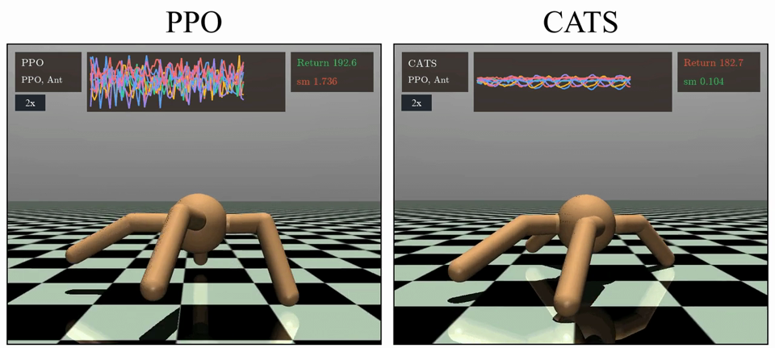
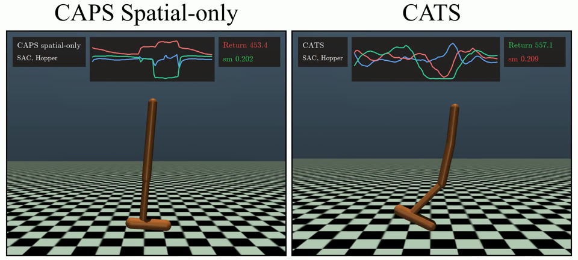
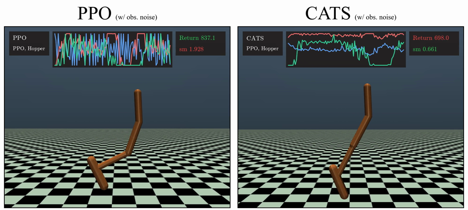
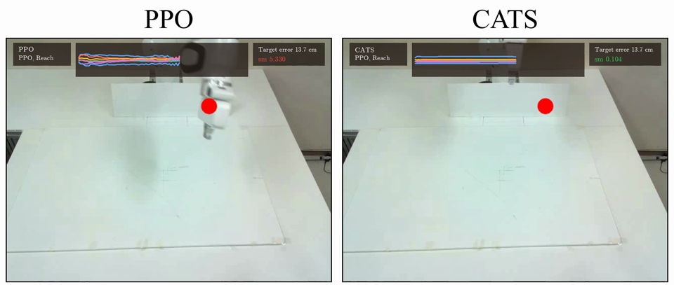
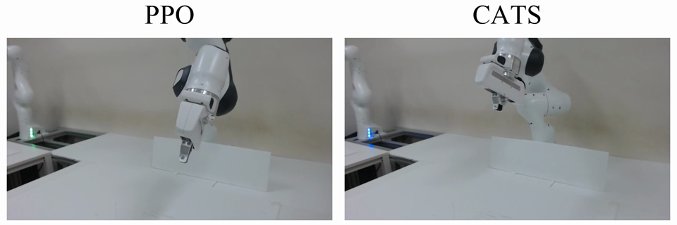

# Revisiting Temporal Regularization for Smooth Control in Deep Reinforcement Learning

**SungJae Ahn, Jeong Woon Lee, Kyoleen Kwak, Hyoseok Hwang**

College of Software, Kyung Hee University

[Paper](https://arxiv.org/abs/2610.07910) | [Benchmark experiments](benchmark/README.md) | [Robot simulation](robotics_sim/README.md)

Official implementation of **CATS (Conditioning for Action using only Temporal Smoothness)**.

## Abstract

Deep Reinforcement Learning policies can produce nonsmooth action oscillations that hinder deployment on physical robots. Existing architectural and penalty-based approaches seek spatial smoothness by directly reducing sensitivity to changes in state inputs, but their broad constraints can degrade task performance as stronger smoothing is pursued. Temporal regularization instead constrains action differences along observed transitions, but has been considered unable to provide the spatial smoothness needed under observation noise. We revisit this assumption by proving that the temporal penalty bounds the expected action differences between current states sharing a next state, revealing a spatial effect that empirically extends to spatial smoothness. Building on this finding, we propose Conditioning for Action using only Temporal Smoothness (CATS), which combines a temporal penalty with linear ramp-up. We highlight temporal regularization's ability to provide spatial smoothness while better preserving task performance than explicit spatial regularization. Through linear ramp-up, CATS allows the policy to learn rewarding behavior before progressively smoothing its actions, improving return preservation and both temporal and spatial smoothness. Experiments in both simulation and the real world show that CATS substantially reduces action oscillation without degrading task performance, with little computational overhead.

This repository contains the PPO and SAC experiments, the hyperparameters used in the paper, and the Reach and Place Cube tasks.

## Results

### Action Smoothness on Ant

[](benchmark/assets/ant_ppo_vs_cats.mp4)

### Spatial Regularization Comparison at Matched Smoothness

[](benchmark/assets/spatial_regularization_vs_cats.mp4)

Because CATS does not directly impose broad constraints, it can provide both forms of smoothness while preserving performance.

### Observation Noise

[](benchmark/assets/hopper_observation_noise.mp4)

The induced spatial smoothness allows CATS to remain smooth and achieve higher returns under observation noise.

### Real-World Reach

| Main view | Additional view |
| --- | --- |
| [](robotics_sim/assets/reach_real_ppo_vs_cats.mp4) | [](robotics_sim/assets/reach_context_ppo_vs_cats.mp4) |

We compare PPO and CATS on a real robot. We recorded an additional camera view to show PPO's small oscillations more clearly.

## Installation

The benchmark uses Python 3.10, PyTorch 2.6.0, Stable-Baselines3 2.5.0,
Gymnasium 1.0.0, and MuJoCo 3.3.3. From the repository root:

```bash
conda create -n cats python=3.10 pip swig -c conda-forge
conda activate cats
python -m pip install -r requirements.txt
```

SWIG and a C/C++ compiler are needed to build Box2D for LunarLander.
On Ubuntu, install the compiler tools with `sudo apt install build-essential`.
For headless MuJoCo rendering, set `MUJOCO_GL=egl` on an EGL-capable GPU system,
or use `MUJOCO_GL=osmesa` with the OSMesa system library installed.

[environment-original.yml](environment-original.yml) preserves the original
environment specification. Robot simulation uses a **separate Isaac Lab
environment**; see its [setup instructions](robotics_sim/README.md).

## Quick Start

Train and evaluate CATS on PPO Hopper using the paper's selected configuration:

```bash
cd benchmark
ALG=ppo
export PYTHONPATH="$PWD:$PWD/$ALG:$PWD/$ALG/tests:$PWD/$ALG/models"
python "$ALG/tests/train_cats.py" --env hopper --device auto
```

This runs the full training budget for ten seeds and evaluates the saved policies.
Set `--workers` to limit concurrent jobs. For SAC, set `ALG=sac` and rerun
the import-path command.

Checkpoints are written under `benchmark/$ALG/results/pths/`, and TensorBoard
logs under `benchmark/$ALG/results/tensorboard_logs/`.

## Reproducing the Paper

The [benchmark guide](benchmark/README.md) follows the experiments in the paper:

1. [Main results and observation noise](benchmark/README.md#1-main-results)
2. [Temporal vs. spatial regularization](benchmark/README.md#2-temporal-vs-spatial-regularization)
3. [Transition-induced spatial effect](benchmark/README.md#3-transition-induced-spatial-effect)
4. [Policy sensitivity and next-state noise](benchmark/README.md#4-policy-sensitivity)
5. [Linear ramp-up](benchmark/README.md#5-linear-ramp-up)
6. [Reach and Place Cube](robotics_sim/README.md)

The main-result checkpoints are reused for observation-noise, spatial-effect,
and policy-sensitivity evaluation. Hyperparameters are stored in
[the selected configurations](benchmark/selected_settings.json) and the
[PPO](benchmark/ppo/tests/modules/params.py) /
[SAC](benchmark/sac/tests/modules/params.py) parameter files.

## Code Structure

| Location | Contents |
| --- | --- |
| [`benchmark/ppo/models/cats_ppo.py`](benchmark/ppo/models/cats_ppo.py) | CATS temporal loss and PPO update |
| [`benchmark/sac/models/cats_sac.py`](benchmark/sac/models/cats_sac.py) | CATS temporal loss and SAC update |
| [`benchmark/cats_common/cats_schedules.py`](benchmark/cats_common/cats_schedules.py) | Regularization coefficient schedules |
| `benchmark/{ppo,sac}/tests/` | Training and evaluation entry points |
| `benchmark/tools/` | Shared evaluation and transition analysis |
| `robotics_sim/` | Isaac Lab tasks, visual policies, training, and evaluation |

## Acknowledgments

Our benchmark implementation builds on [ASAP](https://github.com/AIRLABkhu/ASAP).
We thank its authors for releasing their code, including the PPO/SAC experiment
infrastructure and smoothness evaluation routines on which this repository builds.
The benchmark also uses [Stable-Baselines3](https://github.com/DLR-RM/stable-baselines3).
Robot simulation uses [Isaac Lab](https://github.com/isaac-sim/IsaacLab) and
[rl_games](https://github.com/Denys88/rl_games).

## Citation

If you use this work, please cite:

```bibtex
@misc{ahn2026cats,
  title         = {Revisiting Temporal Regularization for Smooth Control in Deep Reinforcement Learning},
  author        = {SungJae Ahn and Jeong Woon Lee and Kyoleen Kwak and Hyoseok Hwang},
  year          = {2026},
  eprint        = {2610.07910},
  archivePrefix = {arXiv},
  primaryClass  = {cs.LG},
  url           = {https://arxiv.org/abs/2610.07910}
}
```
