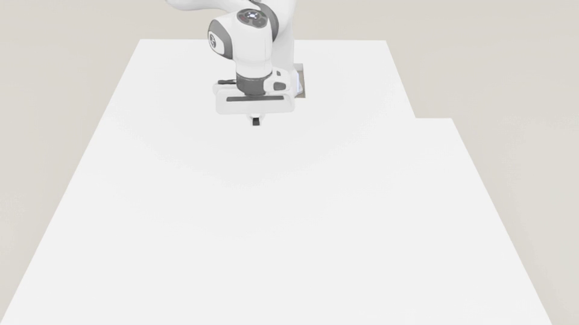
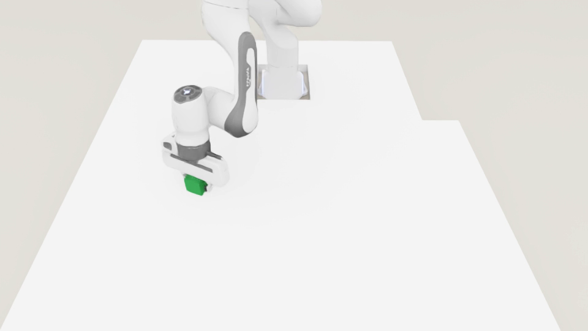

# Robot Simulation

[Back to the project README](../README.md)

Training and evaluation for Reach and Place Cube in Isaac Lab, comparing
Base PPO, CAPS and CATS.

| Reach | Place Cube |
| --- | --- |
|  |  |
| Move the end effector to a target in free space. | Start with a grasped cube and place it at a target on the table. |

### Reach: PPO vs. CATS

**Main view**

[](assets/reach_real_ppo_vs_cats.mp4)

**Additional view**

[](assets/reach_context_ppo_vs_cats.mp4)

[Setup](#setup) | [Policy](#policy-and-observations) |
[Control](#actions-and-control) | [Tasks](#tasks-and-rewards) |
[Regularization](#regularization) | [Training and Evaluation](#training-and-evaluation) |
[Metrics](#evaluation-metrics)

## Setup

Use Isaac Lab 2.2.1 with Isaac Sim 5.0.0 and Python 3.11. Follow the
[Isaac Lab installation guide](https://isaac-sim.github.io/IsaacLab/v2.2.1/source/setup/installation/pip_installation.html)
for simulator installation and system requirements. In that Python environment,
install Isaac Lab and its RL-Games dependencies:

```bash
git clone --branch v2.2.1 --depth 1 https://github.com/isaac-sim/IsaacLab.git
cd IsaacLab
./isaaclab.sh --install rl_games
python -m pip install PyYAML Pillow imageio-ffmpeg
```

The `rl_games` extra installs the Isaac Sim fork's `python3.11` branch,
as specified by [Isaac Lab 2.2.1](https://github.com/isaac-sim/IsaacLab/blob/v2.2.1/source/isaaclab_rl/setup.py).

From the repository root:

```bash
cd robotics_sim
export PYTHONPATH="$PWD/source/er_isaac:$PWD/scripts/rl_games:$PWD/scripts:$PYTHONPATH"
SEED=178132
```

Use the following training seeds for each method:

| Task | Training seeds | Environments | Iterations |
| --- | --- | ---: | ---: |
| Reach | 178132, 410580, 922852, 787576, 660993 | 128 | 3000 |
| Place Cube | 178132, 410580, 922852 | 512 | 1500 |

Run each seed with the commands below.

For evaluation, set `CHECKPOINT` to the trained checkpoint and `AGENT_CFG`
to its saved `agent.yaml`. Each command evaluates five seeds; Reach uses
30 targets per seed and Place Cube uses 50 trials per seed. Keep `goals.json`
for the paired Place Cube target schedule.

## Policy and Observations

Policies receive a fixed-camera RGB image with a target marker, plus robot
measurements and target XYZ in the robot base frame. Joint positions,
velocities, previous actions and end-effector height follow
[Azimi et al.][azimi]; target coordinates and the image marker are additions.

| Input / output | Reach | Place Cube |
| --- | --- | --- |
| RGB image | 84 x 84 x 3 | 84 x 84 x 3 |
| Joint positions / velocities | 7 / 7 | 7 / 7 |
| Previous action | 7 | 8 |
| End-effector height / target XYZ | 1 / 3 | 1 / 3 |
| Total non-image inputs | 25 | 26 |
| Action outputs | 7 arm | 7 arm + gripper |

Both tasks use the same hidden-layer architecture, with task-specific input
and output dimensions. Each policy shares its encoder and MLP between actor
and critic; policies are trained independently.

| Component | Architecture |
| --- | --- |
| Image encoder | ReLU CNN: channels 16/32/64/64, kernels 6/4/3/3, strides 2/2/1/1 |
| Visual projection | 4 x 4 average pooling -> 1024 -> 256 |
| Measurement encoder | 25 or 26 -> 64 -> 128, ReLU |
| Fused MLP | 384 -> 256 -> 128, ReLU |
| Output heads | Gaussian policy mean and scalar value |

See [observations][observations] and [network][network] for fixed input scaling
and implementation. PPO settings are in the [Reach YAML][reach-agent] and
[Place YAML][place-agent].

## Actions and Control

Both tasks use 30 Hz joint-position control with 60 Hz physics:
`joint target = default joint position + 0.5 * policy output`.
Place adds a gripper command; a nonnegative output starts opening, latched
until reset. All methods use the same [controller][controller].

## Tasks and Rewards

Both tasks use the same Table55 table and protective board.

- **Reach:** 18-second episodes with a new target every 6 seconds. Position
  and orientation tracking rewards; action-rate, joint-velocity and low-height
  penalties are disabled. [Scene][reach-scene] / [Rewards][reach-base].
- **Place Cube:** starts with a grasped cube; trials last up to 3 seconds.
  Targets lie on a forward semicircle of radius 0.25 m centered at XY (0.45, 0).
  Rewards cover transport, lowering, release and stillness near the goal.
  [Scene][place-config] / [Reward logic][placement-math].

## Regularization

CATS and CAPS regularize the seven arm policy means, excluding the gripper.
CATS linearly increases the temporal coefficient to `--alpha-max` and masks
transitions ending in a reset. CAPS uses fixed temporal and spatial coefficients.

CAPS perturbs RGB, joint positions/velocities and end-effector height with
Gaussian noise, leaving previous actions and target coordinates unchanged.
Reach also preserves target-marker pixels. See [CATS][cats-agent] and
[CAPS perturbations][caps-loss].

## Training and Evaluation

### Reach

**Base PPO**

```bash
python scripts/rl_games/train.py \
  --task Franka-Reach-v0 \
  --agent rl_games_goal_fixed_scale_cfg_entry_point \
  --mode base \
  --seed "$SEED" --num_envs 128 --max_iterations 3000 \
  --headless --enable_cameras
```

**CAPS**

```bash
python scripts/rl_games/train.py \
  --task Franka-Reach-v0 \
  --agent rl_games_goal_fixed_scale_cfg_entry_point \
  --mode caps \
  --seed "$SEED" --num_envs 128 --max_iterations 3000 \
  --headless --enable_cameras \
  --caps-lambda-t 0.5 \
  --caps-lambda-s 0.1 \
  --caps-sigma 0.2 \
  --caps-preserve-target-overlay
```

**CATS**

```bash
python scripts/rl_games/train.py \
  --task Franka-Reach-v0 \
  --agent rl_games_goal_fixed_scale_cfg_entry_point \
  --mode cats \
  --seed "$SEED" --num_envs 128 --max_iterations 3000 \
  --headless --enable_cameras \
  --alpha-max 5.0
```

**Evaluation**

```bash
METHOD=cats  # base, caps, or cats
OUT="results/reach/$METHOD/seed_$SEED"
mkdir -p "$OUT"
python scripts/eval_success.py \
  --checkpoint "$CHECKPOINT" \
  --agent-cfg "$AGENT_CFG" \
  --task Franka-Reach-Eval-v0 \
  --headless --enable_cameras \
  --targets 30 \
  --eval-seeds 652165 709797 242820 579787 70701 \
  --out "$OUT/evaluation.mp4" \
  --summary "$OUT/summary.json"
```

### Place Cube

**Base PPO**

```bash
python scripts/rl_games/train.py \
  --task Franka-PlaceCube-v0 \
  --agent rl_games_goal_fixed_scale_cfg_entry_point \
  --mode base \
  --seed "$SEED" --num_envs 512 --max_iterations 1500 \
  --headless --enable_cameras
```

**CAPS**

```bash
python scripts/rl_games/train.py \
  --task Franka-PlaceCube-v0 \
  --agent rl_games_goal_fixed_scale_cfg_entry_point \
  --mode caps \
  --seed "$SEED" --num_envs 512 --max_iterations 1500 \
  --headless --enable_cameras \
  --caps-lambda-t 0.5 \
  --caps-lambda-s 0.1 \
  --caps-sigma 0.2
```

**CATS**

```bash
python scripts/rl_games/train.py \
  --task Franka-PlaceCube-v0 \
  --agent rl_games_goal_fixed_scale_cfg_entry_point \
  --mode cats \
  --seed "$SEED" --num_envs 512 --max_iterations 1500 \
  --headless --enable_cameras \
  --alpha-max 1.0
```

**Evaluation**

```bash
METHOD=cats  # base, caps, or cats
OUT="results/place_cube/$METHOD/seed_$SEED"
mkdir -p "$OUT"
python scripts/evaluation/eval_place.py \
  --checkpoint "$CHECKPOINT" \
  --agent-cfg "$AGENT_CFG" \
  --task Franka-PlaceCube-Eval-v0 \
  --headless --enable_cameras \
  --trials 50 \
  --eval-seeds 652165 709797 242820 579787 70701 \
  --goal-schedule goals.json \
  --out "$OUT/summary.json"
```

## Evaluation Metrics

### Reach Success

Use `success_rate` for staying within 5 or 10 cm continuously for one second,
not `minimum_distance_success_rate`.

### Place Cube Success

After Place evaluation, compute the reported success metric:

```bash
python score_place.py "$OUT/summary.json" \
  --output "$OUT/reported_metrics.json"
```

Success requires XY error at most 5 cm, cube height within 0.0505 m +/- 0.005 m,
table contact, gripper width at least 0.06 m and no finger contact, with no
hold-time requirement. This differs from the training success metric.

### Smoothness

Evaluation uses deterministic policy means. The [smoothness score][metrics]
is computed from the seven arm outputs before controller scaling at 30 Hz,
then averaged over coordinates and trials or target windows. Lower is smoother.

### Aggregation

Average evaluation trials within each trained policy, then report the
training-seed mean and untruncated 95% t-confidence interval.

[azimi]: https://arxiv.org/abs/2606.18594
[observations]: source/er_isaac/er_isaac/tasks/manager_based/er_isaac/mdp/observation.py
[network]: scripts/rl_games/models/visual_proprio_network.py
[controller]: source/er_isaac/er_isaac/tasks/manager_based/er_isaac/config/franka/joint_pos_camera_env_cfg.py
[reach-base]: source/er_isaac/er_isaac/tasks/manager_based/er_isaac/reach_cfg.py
[place-config]: source/er_isaac/er_isaac/tasks/manager_based/er_isaac/config/franka/pregrasped_placement_env_cfg.py
[placement-math]: source/er_isaac/er_isaac/tasks/manager_based/er_isaac/mdp/placement_math.py
[cats-agent]: scripts/rl_games/models/a2c_continuous_cats.py
[caps-loss]: scripts/rl_games/models/caps.py
[reach-agent]: source/er_isaac/er_isaac/tasks/manager_based/er_isaac/config/franka/agents/reach_ppo.yaml
[place-agent]: source/er_isaac/er_isaac/tasks/manager_based/er_isaac/config/franka/agents/place_ppo.yaml
[metrics]: scripts/evaluation/action_metrics.py

[reach-scene]: source/er_isaac/er_isaac/tasks/manager_based/er_isaac/config/franka/reach_table_env_cfg.py
